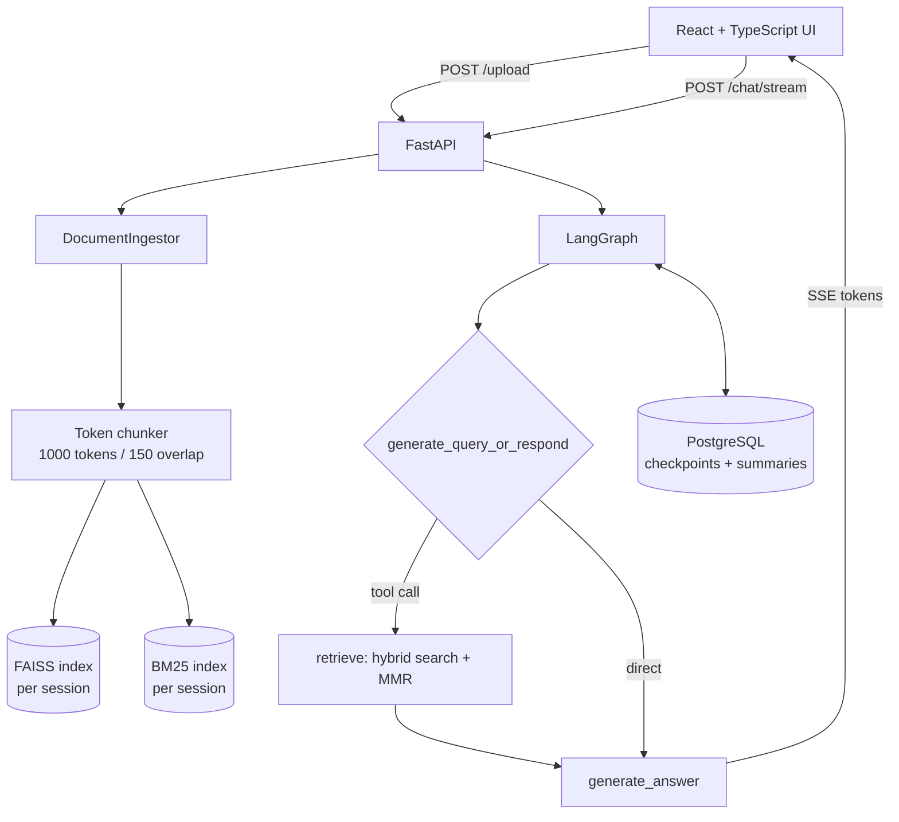

# llmops_rag

A self-hosted document Q&A service: upload PDFs, DOCX or TXT files into an isolated session, then ask questions in a chat UI that streams answers and cites the file and page each claim came from. Retrieval is hybrid (dense + keyword), conversation state lives in PostgreSQL, and the workflow is built with LangGraph.

It runs as a single container: the FastAPI process serves both the API and the compiled React frontend.

## What it does

- **Session-scoped indexes.** Every upload session gets its own document store and its own FAISS index. Sessions do not see each other's files.
- **Hybrid retrieval.** Dense search over `text-embedding-3-large` (weight 0.7) combined with BM25 keyword search (weight 0.3), then MMR re-ranking for diversity. The split exists because keyword search wins on exact strings (clause numbers, product codes, names) where embeddings blur them.
- **The model decides when to retrieve.** A router node either answers directly or calls the retrieval tool, so greetings and follow-ups do not pay for a search.
- **Citations.** Retrieved chunks are formatted as `[Source: file_name, Page: N]` before they reach the answer prompt, and the prompt instructs the model to keep them.
- **Streaming over SSE.** Tokens are pushed as they are produced, with status events for the retrieval step so the UI is not silent during the search.
- **Persistent memory.** LangGraph checkpoints into PostgreSQL, so a conversation survives a restart. Long threads are summarised by a dedicated node rather than truncated, and the summary replaces the older turns.
- **Multi-document sessions** with idempotent ingest: re-uploading the same file does not duplicate chunks, and deleting a file rebuilds the index for that session.

## Architecture



The graph:

```
START -> summarize -> generate_query_or_respond
                          |-> retrieve -> generate_answer -> END
                          |-> END (direct answer)
```

## Repository map

```
multi_doc_chat/
  api/                 FastAPI app, routes, pydantic schemas
  src/
    document_ingestion/  loading, chunking, hybrid retriever, retriever tool
    document_chat/       graph nodes and graph builder
    session_runner.py    CLI runner (new / resume)
  utils/               config loader, model loader, checkpointer, file I/O
  config/config.yaml   every tunable in one file
UI/                    React 19 + Vite + TypeScript frontend
tests/unit             3 modules: ingestion, document ops, file I/O
tests/integration      1 module: full session flows
run_evaluations.py     LangSmith evaluation, LLM-as-judge correctness
```

## Quick start

### Docker

```bash
cp .env.example .env          # fill in OPENAI_API_KEY and POSTGRES_URI
docker compose up --build
# UI and API: http://localhost:8100
```

PostgreSQL is external: point `POSTGRES_URI` at any reachable instance (a managed one is fine). Tables are created on first start. If you want the database in the same compose file, add one and change the URI to its service name.

### Local

```bash
python -m venv .venv && source .venv/bin/activate
pip install -r requirements.txt

cd UI && npm ci && npm run build && cd ..

uvicorn multi_doc_chat.api.main:app --port 8000 --reload
```

For frontend development with hot reload, run `npm run dev` inside `UI/` and set `VITE_API_BASE_URL=http://localhost:8000` in `UI/.env.local`; otherwise the UI calls the same origin it was served from.

### CLI

```bash
# one-shot: index files and ask a question in the terminal
python -m multi_doc_chat.src.session_runner new "What are the notice periods?" doc1.pdf doc2.docx

# continue a previous session
python -m multi_doc_chat.src.session_runner resume session_20251107_145458_d0fcb19d "And for contractors?"
```

## Configuration

Everything tunable lives in `multi_doc_chat/config/config.yaml`. Current defaults:

| Key | Value | Why |
|---|---|---|
| `embedding_model` | `text-embedding-3-large` | best retrieval quality on the OpenAI tier this was built against |
| `hybrid_retriever` | vector 0.7 / bm25 0.3, MMR, `fetch_k` 20 | dense search carries paraphrase, BM25 carries exact strings |
| `text_splitter` | 1000 tokens, 150 overlap, tiktoken | token counts match what the model is billed for |
| `llm.response` | `gpt-4.1-mini`, temperature 0.3 | answers |
| `llm.grader` | `gpt-4.1-mini`, temperature 0 | routing decisions |
| `summarization` | summarise at 200k tokens | memory degrades long before the context window fills |
| `file_limits` | 20 MB per file, 100 MB per session, 15 files | keeps one session from starving the process |

## API

| Method | Path | Purpose |
|---|---|---|
| POST | `/upload` | upload one or more files and create a session |
| POST | `/ingest?session_id=` | add files to an existing session |
| POST | `/chat` | blocking answer |
| POST | `/chat/stream` | SSE stream with `status`, `token` and `done` events |
| GET | `/sessions/{id}/status` | indexing state |
| GET | `/sessions/{id}/files` | files in the session |
| GET | `/sessions/{id}/history` | stored conversation |
| GET | `/sessions/{id}/sample-questions` | suggested questions drawn from the indexed text |
| DELETE | `/sessions/{id}/files/{name}` | remove one file and rebuild the index |
| DELETE | `/sessions/{id}` | delete the session |
| GET | `/health`, `/health/db` | liveness and database check |
| GET | `/docs` | OpenAPI UI |

```bash
curl -X POST http://localhost:8100/upload -F "files=@handbook.pdf"
curl -N -X POST http://localhost:8100/chat/stream \
  -H "Content-Type: application/json" \
  -d '{"session_id":"session_20251107_145458_d0fcb19d","message":"How much notice for resignation?"}'
```

## Tests and CI

```bash
pytest tests/unit          # no network, no API key
pytest tests/integration   # session flows
```

GitHub Actions runs the suite on every push to `main` and on every pull request: `uv` installs the pinned requirements, then `pytest -q` runs with a dummy `OPENAI_API_KEY`, so CI never reaches a paid API.

## Deployment

`.github/workflows/aws.yml` is a reference pipeline: it builds the image, pushes it to ECR (`llmopsrepolive`), and updates an ECS Fargate service (`llmops-live-service` in `llmops-live-cluster`, region `us-east-1`) through a GitHub OIDC role. No long-lived AWS keys are stored in the repository.

**Status: a template, not a working pipeline right now.** It is set to `workflow_dispatch` only, so it cannot red-flag every commit while the AWS side is missing. To use it you need an existing ECS cluster, service and task definition, an IAM role trusting `token.actions.githubusercontent.com`, and the role ARN in repository variables; then re-enable the `workflow_run` trigger commented at the top of the file. The one automatic run it did (2026-04-16) failed on those missing pieces after CI had passed.

## What this does not do

Written down so nobody infers it from the feature list:

- **No authentication or tenancy.** The API is open and CORS is `*`. Put it behind an authenticating proxy before it faces anyone but you.
- **One replica only.** FAISS indexes live on the API process's filesystem and session state is per process, so two containers behind a load balancer would not see each other's sessions.
- **No reranker.** MMR improves diversity; it does not reorder by relevance with a cross-encoder.
- **Retrieval quality is not measured here.** `run_evaluations.py` can score answers against a LangSmith dataset with an LLM judge, but no dataset ships with the repository, so there are no published accuracy numbers. The tests check plumbing, not answer quality.
- **Long PDFs are slow to ingest**, because chunking and embedding run inline in the upload request.

## Cost, roughly

List prices at the time of writing, worth re-checking: `text-embedding-3-large` around $0.13 per million tokens, `gpt-4.1-mini` around $0.40 in / $1.60 out per million. A 200-page handbook is roughly 100k tokens, so about a cent to embed, and a question that retrieves eight chunks and answers in 300 tokens costs well under a cent.

## License

MIT. See [LICENSE](LICENSE).

Built by [Hoang Hieu Nguyen](https://github.com/chrisHHieu) with LangGraph, LangChain, FAISS and FastAPI.
